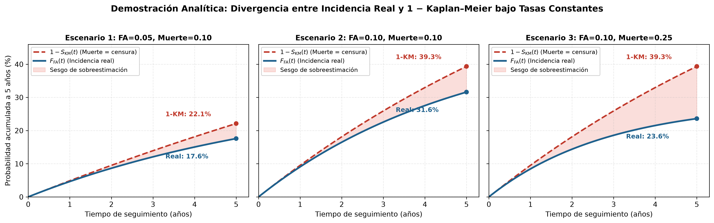
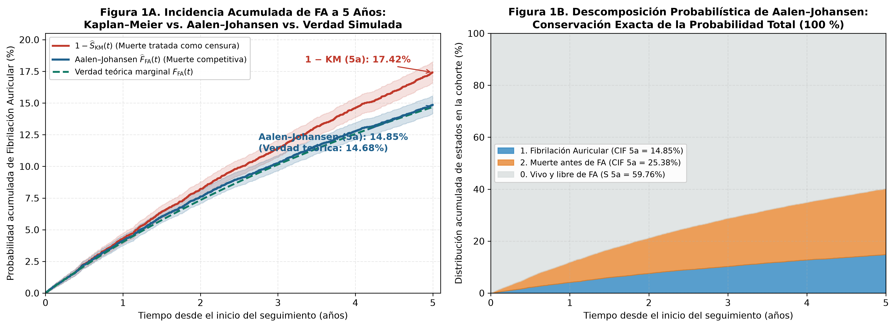
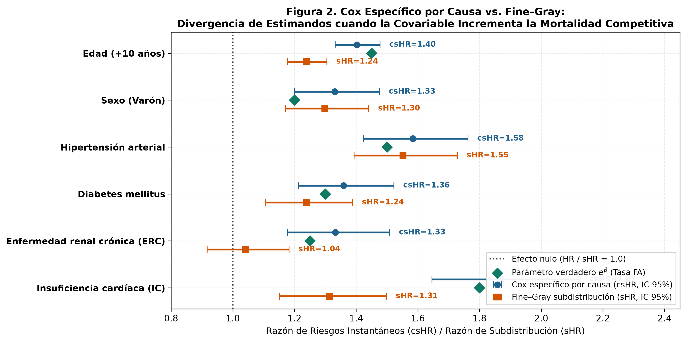
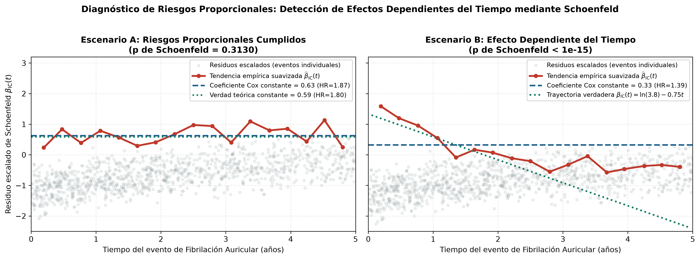
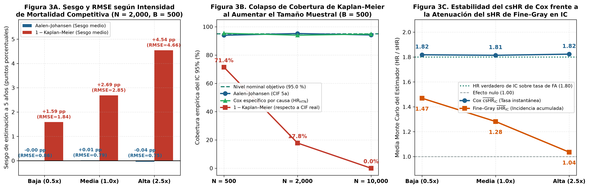

# Estudio Computacional sobre Riesgos Competitivos en Fibrilación Auricular a Cinco Años

**Comparación metodológica reproducible: Kaplan–Meier vs. Aalen–Johansen y Cox de Causa Específica vs. Fine–Gray**

📓 **Notebook completo ejecutado:** [`Estudio_Riesgos_Competitivos_Fibrilacion_Auricular.ipynb`](./Estudio_Riesgos_Competitivos_Fibrilacion_Auricular.ipynb)

---

## 1. Pregunta de Investigación

> *En una cohorte hipotética de $N = 10{,}000$ adultos (40–90 años) inicialmente libres de fibrilación auricular (FA), ¿cómo cambia la estimación de su incidencia acumulada a cinco años cuando se considera la muerte previa como un evento competitivo, en comparación con tratarla como censura?*

### Cuestiones investigadas
1. **Incidencia acumulada absoluta:** ¿Cuánto difiere la estimación ingenua $1 - \widehat{S}_{\mathrm{KM}}(t)$ de la probabilidad real de desarrollar FA antes de morir ($F_{\mathrm{FA}}(t)$) y del estimador no paramétrico de **Aalen–Johansen** ($\widehat{F}_{\mathrm{FA}}(t)$)?
2. **Modelos de regresión:** ¿Cómo cambian la magnitud y la interpretación de las covariables entre el modelo de **Cox de riesgos específicos por causa** ($\mathrm{csHR} = e^{\beta}$) y el modelo de subdistribución de **Fine–Gray** ($\mathrm{sHR} = e^{\beta_{\mathrm{FG}}}$)?
3. **Propiedades frecuentistas (Monte Carlo $B = 500$) y análisis de sensibilidad:** ¿Cómo evolucionan el sesgo, el $\mathrm{RMSE}$ y la cobertura empírica del IC 95 % al variar la intensidad de la mortalidad competitiva ($0.5\times, 1.0\times, 2.5\times$), el tamaño muestral ($N \in \{500, 2{,}000, 10{,}000\}$), la forma del riesgo basal (Weibull $\kappa \in \{0.75, 1.00, 1.35\}$) o al violar el supuesto de riesgos proporcionales?

---

## 2. Resultados Principales Verificados

| Método / Escenario | Estimando | Resultado a 5 años ($N = 10{,}000$) | Interpretación Metodológica |
| :--- | :--- | :--- | :--- |
| **Verdad Teórica Marginal** | $F_{\mathrm{FA}}(5)$ | **14.68 %** | Probabilidad real exacta de desarrollar FA antes de fallecer |
| **Aalen–Johansen** | $\widehat{F}_{\mathrm{FA}}(5)$ | **14.85 %** `[14.15 %, 15.56 %]` | Insesgado; conserva la suma de probabilidades ($\mathrm{FA} + \mathrm{Muerte} + \mathrm{Supervivencia} = 100\%$) |
| **1 − Kaplan–Meier (Muerte = censura)** | $1 - \widehat{S}_{\mathrm{KM}}(5)$ | **17.42 %** `[16.60 %, 18.24 %]` | Sobreestima la incidencia real en **+2.73 pp** (+18.6 % relativo); cobertura IC 95 % = **0.0 %** en $N=10{,}000$ |
| **Cox Específico por Causa (IC)** | $\mathrm{csHR}_{\mathrm{IC}}$ | **1.870** `[1.65, 2.13]` | Recupera la tasa instantánea verdadera ($\mathrm{HR} = 1.80$) entre supervivientes |
| **Fine–Gray Subdistribución (IC)** | $\mathrm{sHR}_{\mathrm{IC}}$ | **1.314** `[1.15, 1.50]` | Refleja la atenuación sobre la incidencia acumulada por alta mortalidad competitiva ($\mathrm{HR}_{\mathrm{Muerte}} = 2.80$) |
| **Cox vs. Fine–Gray en ERC (`ckd`)** | $\mathrm{csHR}$ vs. $\mathrm{sHR}$ | **1.332** vs. **1.041** ($p=0.52$) | La mortalidad competitiva ($\mathrm{HR}_{\mathrm{Muerte}} = 2.20$) neutraliza el exceso de incidencia acumulada |

---

## 3. Figuras del Estudio

### Demostración Analítica Determinística


### Figura 1. Kaplan–Meier vs. Aalen–Johansen vs. Verdad Teórica ($N = 10{,}000$)


### Figura 2. Cox Específico por Causa ($\mathrm{csHR}$) vs. Fine–Gray ($\mathrm{sHR}$)


### Figura 3. Diagnóstico de Riesgos Proporcionales (Residuos Escalados de Schoenfeld)


### Figura 4. Estudio Monte Carlo ($B = 500$) y Análisis de Sensibilidad


---

## 4. Reproducibilidad e Instrucciones de Ejecución

```bash
python -m venv .venv
# En Windows:
.venv\Scripts\activate
pip install -r requirements.txt
```

- **Semilla maestra:** `MASTER_SEED = 2026`
- **Nota ética y metodológica:** Todos los datos de este repositorio provienen de un generador de simulación estocástica controlada y no representan registros clínicos de pacientes reales.
